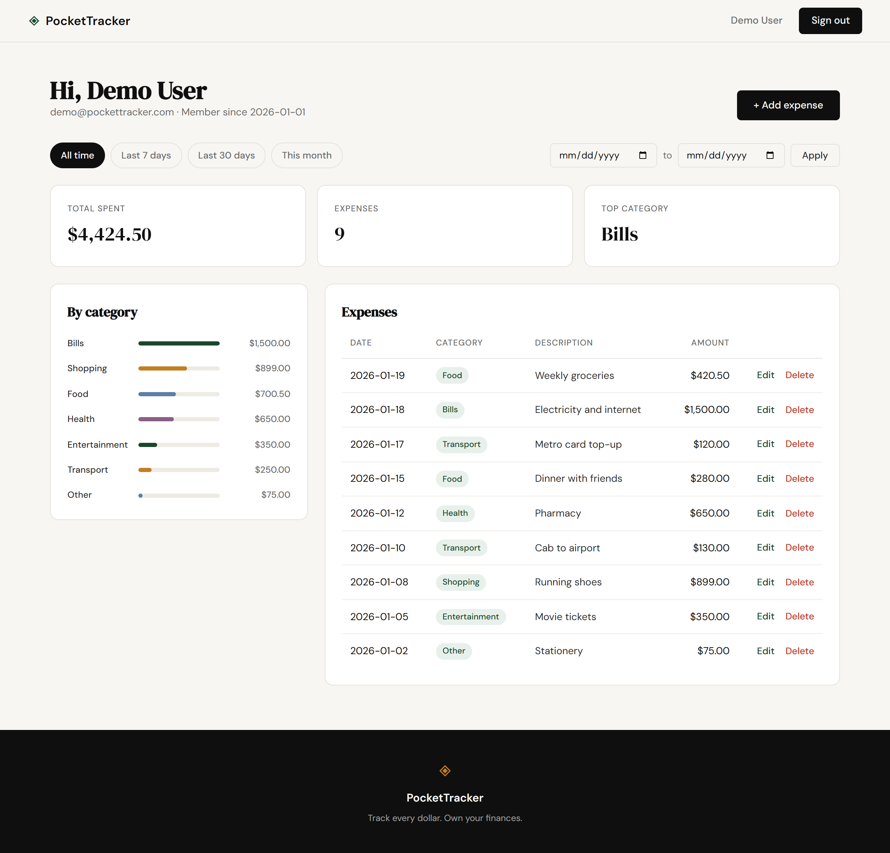
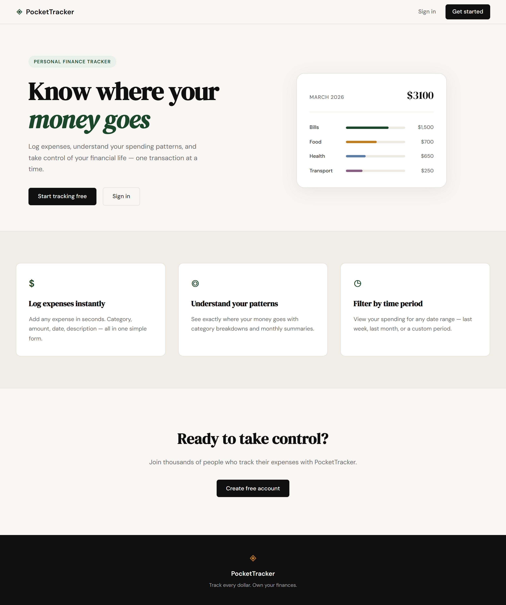
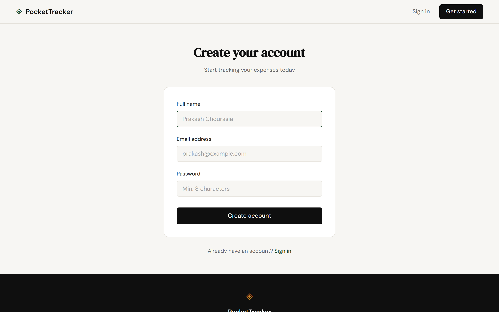
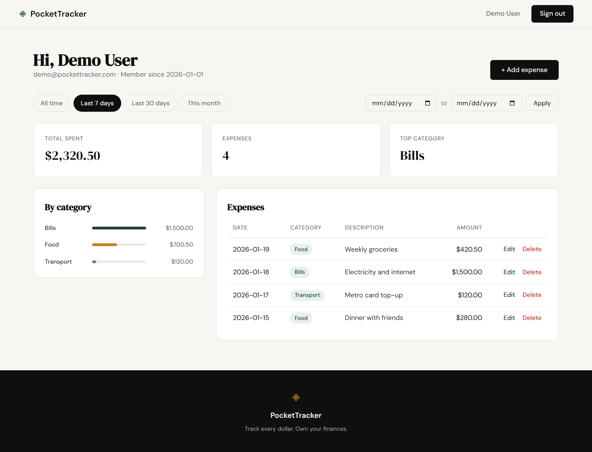
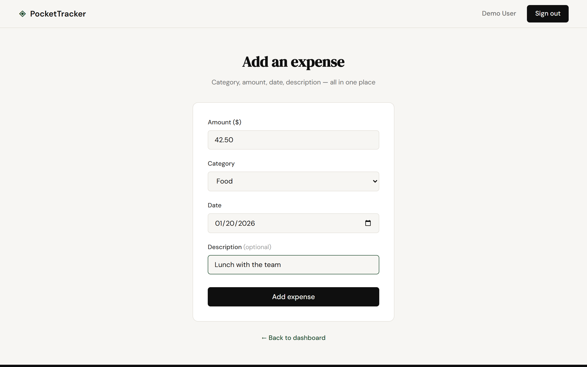
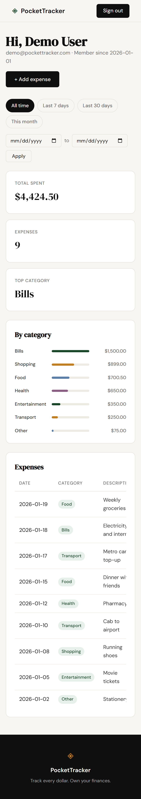

# PocketTracker

**Know where your money goes.** PocketTracker is a personal expense tracker built with Flask and SQLite. Log expenses, see where your money goes by category, and filter your spending by any time period.



## Features

- **Accounts** — register, sign in and sign out. Passwords are hashed; each user only ever sees their own expenses.
- **Log expenses** — amount, category, date and an optional description, with validation that keeps your input when something's wrong.
- **Dashboard** — total spent, number of expenses, top category, a per-category breakdown and a full expense list.
- **Filter by time period** — all time, last 7 days, last 30 days, this month, or a custom date range.
- **Edit and delete** — every expense can be changed or removed (deleting asks for confirmation).
- **Responsive** — works on desktop and mobile.

## Screenshots

| Landing page | Sign up |
|---|---|
|  |  |

| Filtered to the last 7 days | Adding an expense |
|---|---|
|  |  |

<p align="center">
  
  <br><em>Dashboard on mobile</em>
</p>

## Tech stack

- **Backend:** Python 3, Flask 3
- **Database:** SQLite (via Python's built-in `sqlite3`)
- **Auth:** Flask sessions + Werkzeug password hashing
- **Frontend:** Jinja2 templates, plain CSS and a little vanilla JavaScript — no build step

## Getting started

### 1. Clone the repo

```bash
git clone https://github.com/pchourasia1/PocketTracker.git
cd PocketTracker
```

### 2. Create a virtual environment and install dependencies

**Windows**

```bash
python -m venv venv
venv\Scripts\activate
pip install -r requirements.txt
```

**macOS / Linux**

```bash
python3 -m venv venv
source venv/bin/activate
pip install -r requirements.txt
```

### 3. Run the app

```bash
python app.py
```

Open **http://127.0.0.1:5001**. The database (`expense_tracker.db`) is created automatically on first run and seeded with a demo account.

### Demo account

| Email | Password |
|---|---|
| `demo@pockettracker.com` | `demo1234` |

The demo account comes with 9 sample expenses from the last few weeks. To start fresh, stop the app and delete `expense_tracker.db`.

## Configuration

| Environment variable | Purpose | Default |
|---|---|---|
| `SECRET_KEY` | Signs session cookies. **Set this to a long random value in any real deployment.** | `dev-only-change-me` |

## Project structure

```
.
├── app.py                  # Flask app: routes, auth, validation
├── database/
│   └── db.py               # get_db(), init_db(), seed_db(), CATEGORIES
├── templates/
│   ├── base.html           # Layout: navbar, footer
│   ├── landing.html        # Marketing page
│   ├── register.html       # Sign up
│   ├── login.html          # Sign in
│   ├── profile.html        # Dashboard
│   └── expense_form.html   # Add / edit expense
├── static/
│   ├── css/style.css
│   └── js/main.js          # Delete confirmation
├── docs/screenshots/       # Images used in this README
└── requirements.txt
```

## Routes

| Method | Path | Description |
|---|---|---|
| GET | `/` | Landing page |
| GET, POST | `/register` | Create an account |
| GET, POST | `/login` | Sign in |
| GET | `/logout` | Sign out |
| GET | `/profile` | Dashboard (`?period=all\|7d\|30d\|month`, or `?period=custom&start=YYYY-MM-DD&end=YYYY-MM-DD`) |
| GET, POST | `/expenses/add` | Add an expense |
| GET, POST | `/expenses/<id>/edit` | Edit an expense |
| POST | `/expenses/<id>/delete` | Delete an expense |

All `/profile` and `/expenses/...` routes require you to be signed in. Expenses that belong to another user return 404.

## Database schema

**users** — `id`, `name`, `email` (unique), `password_hash`, `created_at`

**expenses** — `id`, `user_id` → `users.id` (cascade delete), `amount` (> 0), `category`, `date` (`YYYY-MM-DD`), `description`, `created_at`

Categories: Food, Transport, Bills, Health, Shopping, Entertainment, Other.

## Roadmap

- Automated tests with `pytest` / `pytest-flask` (already in `requirements.txt`)
- CSRF protection on forms (e.g. Flask-WTF)
- Monthly summaries and charts over time
- Export expenses to CSV
